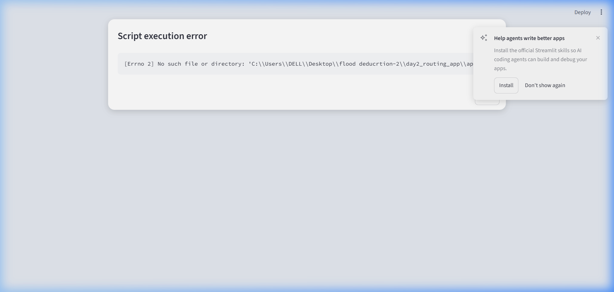

# 🛡️ EvacRoute: Multi-Hazard Decision Support & Emergency Routing System

[](https://streamlit.io)
[](https://earthengine.google.com/)
[](https://openstreetmap.org)
[](https://opensource.org/licenses/MIT)

<div align="center">
  
</div>

**EvacRoute** is a real-time geospatial decision-support system developed for disaster evacuation planning. It couples multi-hazard risk modeling with network graph optimization on physical road networks to compute **least-risk emergency evacuation corridors** rather than blindly taking the shortest distance path.

---

## 🎯 The Challenge & Problem Statement
During severe climate events (floods, flash floods, landslides, and slope failures), standard navigation tools (e.g., Google Maps, Waze) calculate routes based solely on travel time or distance. In disaster scenarios, this frequently routes evacuating citizens and emergency responders straight through submerged river basins, washed-out roads, or active landslide corridors.

**EvacRoute** solves this by:
1. Generating continuous, normalized multi-hazard raster layers (Flood + Landslide/Slope).
2. Constructing an **MCDM (Multi-Criteria Decision Making)** risk index.
3. Overlaying the risk surface onto real **OpenStreetMap road graphs**.
4. Executing risk-penalized Dijkstra pathfinding to route people safely around hazard corridors.

---

## ✨ Key Features & Capabilities

<div align="center">
  
  <p><em>Real-time generation of risk-penalized evacuation routes vs standard shortest paths</em></p>
</div>

- **🛰️ Multi-Hazard MCDM Integration**:
  - **Landslide Vulnerability**: Sourced from Copernicus GLO-30 DEM slope modeling.
  - **Inundation Exposure**: Sourced from JRC Global Surface Water occurrence and low-elevation flood basins.
  - **User-Adjustable Weights**: Customizable sliders for disaster commanders to tailor priority weights.
- **🛣️ Intelligent Evacuation Pathfinding**:
  - Uses `osmnx` and `networkx` to model driveable road networks.
  - Cost function: $\text{Cost}(e) = \text{Length}(e) \times (1 + \text{Risk}(e) \times 18)$.
  - Provides dual-path comparison: 🔵 **Standard Shortest Path** vs. 🔴 **SafeRoute Evacuation Corridor**.
- **🏥 Critical Infrastructure Mapping**:
  - Ingests hospitals, clinics, emergency shelters, and relief facilities live from OpenStreetMap.
- **📊 Real-Time Decision Support Analytics**:
  - Quantitative metrics displaying distance trade-offs, hazard exposure scores, and **% Life Safety Gain**.
- **💾 GIS Data Export**:
  - One-click export of calculated evacuation corridors as standard **GeoJSON**.
- **⚡ 1-Click Demo Scenarios**:
  - Pre-configured regional disaster scenarios (Himalayan Flash Floods & Western Ghats Slope Failures).

---

## 📂 Repository Structure

```
├── app.py                # Main Streamlit web application & UI
├── gee_hazards.py        # Earth Engine multi-hazard MCDM algorithms
├── routing_engine.py     # OSMnx road network extraction & risk-penalized Dijkstra
├── requirements.txt      # Python dependencies
├── plan.md               # Engineering roadmap & architectural decisions
├── status.md             # Project verification & task tracking
└── README.md             # Project documentation
```

---

## 🚀 Installation & Local Execution

### 1. Clone the Repository
```bash
git clone https://github.com/sai-67v/EvacRoute.git
cd EvacRoute
```

### 2. Install Dependencies
```bash
pip install -r requirements.txt
```

### 3. Run the Web Application
```bash
streamlit run app.py
```
Open your browser at `http://localhost:8501`.

---

## 🛠️ Tech Stack
- **Web Interface**: [Streamlit](https://streamlit.io/)
- **Geospatial & Remote Sensing**: [Google Earth Engine Python API](https://developers.google.com/earth-engine), [Folium](https://python-visualization.github.io/folium/)
- **Road Network Analysis**: [OSMnx](https://osmnx.readthedocs.io/), [NetworkX](https://networkx.org/), [GeoPandas](https://geopandas.org/)
